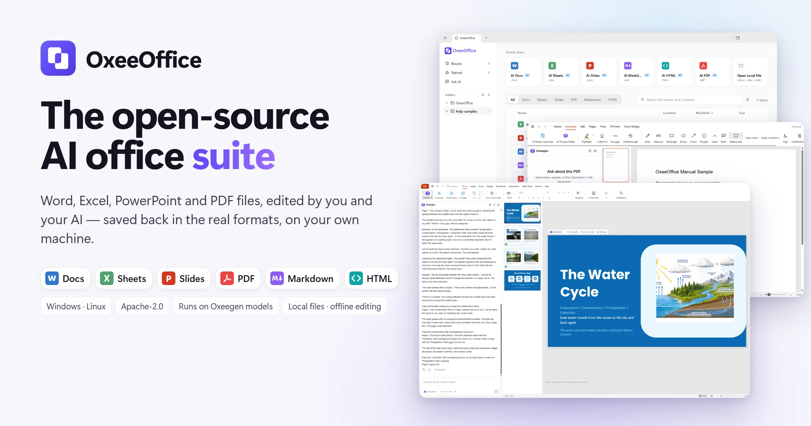

<p align="center">
  <a href="https://github.com/Oxeegen/OxeeOffice/releases/latest">
    <picture>
      <source srcset="brand/assets/readme/hero-dark.webp" media="(prefers-color-scheme: dark)">
      
    </picture>
  </a>
</p>

<h1 align="center">OxeeOffice</h1>

<p align="center">
  <sub><strong>English</strong> · <a href="docs/i18n/README.fr.md">Français</a></sub>
</p>

<p align="center"><b>Oxeegen's AI office suite.</b><br>
Word, Excel, PowerPoint and PDF files, edited by you and your AI, saved back in the real formats —
running on Oxeegen's own models.</p>

<p align="center">
  <a href="LICENSE"></a>
  <a href="https://github.com/Oxeegen/OxeeOffice/releases/latest"></a>
  <a href="https://github.com/Oxeegen/OxeeOffice/releases"></a>
  <a href="https://github.com/Oxeegen/OxeeOffice/stargazers"></a>
  
</p>

<p align="center">
  <a href="#download"><b>Download</b></a> ·
  <a href="#skills"><b>Skills</b></a> ·
  <a href="#command-line-and-agent-skill"><b>CLI</b></a> ·
  <a href="#mcp-server"><b>MCP</b></a> ·
  <a href="https://www.oxeegen.com"><b>Oxeegen</b></a> ·
  <a href="PRIVACY.md"><b>Privacy</b></a>
</p>

OxeeOffice is a desktop office suite for Windows and Linux. It opens and saves
native `.docx`, `.xlsx` and `.pptx` files, edits PDF, Markdown and HTML, and puts
an AI agent next to every document — not a chat box bolted on the side, but an
editor that reads the file, makes the change, and shows you exactly what it
touched. OpenDocument files (`.odt`, `.ods`, `.odp` and the `.ott`/`.ots`/`.otp`
templates), legacy Word `.doc`/`.dot`, PowerPoint `.ppt` and Hancom `.hwp`/`.hwpx`
documents open as editable Office copies; those imports are open-only, and saving
writes the Office format, never the source format.

- **Real formats, byte-preserving.** Only what you edit is rewritten. Everything
  else in the file survives byte-for-byte, so documents keep working in Word,
  Excel and PowerPoint.
- **AI you can review.** Edits land as tracked changes and diffs with one-click
  rollback. Spreadsheets get live formulas, not pasted numbers. Decks and pages
  are generated onto the canvas and stay fully editable. Hide a Docs selection
  or a Sheets cell range from the model and the AI sees only a named
  placeholder; the original words stay in the file. Hiding covers the app's own
  AI — the command line, MCP tools and headless export read the file directly
  and still see those words.
- **Local by design.** Files open, edit, save and convert on your machine.
  PDF → Word / Excel / PowerPoint, Markdown → Word and HTML → Word all run
  on-device. Only the AI calls leave the machine, to the provider you choose.
- **Find files by what they say.** The home screen searches the names, folders
  and full text of your `.docx`, `.xlsx`, `.pptx`, PDF, Markdown and HTML files
  from a local index, CJK included. Optionally, the top hits are reranked by
  **[TypeSafe Jev](https://typesafe.ai/)**, so the file that answers your
  question comes first.
- **Ask your files, with sources.** Star a set of documents and **Ask AI** on the
  home screen answers questions across them, citing the file behind every claim
  so you can open it and check — and builds new documents from them on request.
- **Oxeegen models by default.** AI runs on Oxeegen's self-hosted,
  OpenAI-compatible inference. You can also bring your own key for Claude,
  OpenAI, Gemini, DeepSeek, Mistral, OpenRouter and many others, or any
  OpenAI-compatible endpoint, local servers included.
- **Scriptable and agent-ready.** The app ships a command line and a skill for
  Claude Code, Codex, Cursor, Gemini CLI, GitHub Copilot, OpenCode and Windsurf,
  so a coding agent can create, convert, read and edit real Office files on your
  machine without opening a window.
- **Updates itself.** Installed apps check this repository's releases and offer
  each new version.

**Get it:** [Windows](https://github.com/Oxeegen/OxeeOffice/releases/latest) (x64) ·
[Linux](https://github.com/Oxeegen/OxeeOffice/releases/latest) (deb, rpm, AppImage) —
details and requirements in [Download](#download).

## The apps

Six editors, one AI panel, a file search reranked by TypeSafe Jev, an Ask AI that
answers from your starred files with sources, and a command line for your coding
agent.

### 1 · Docs — open and edit `.docx` with an AI you can review

<table>
<tr>
<td width="50%"></td>
<td width="50%"></td>
</tr>
<tr>
<td><b>Opens the file as Word lays it out</b> — two-column sections, full-bleed images, shaded tables, headers and footers, pagination on Word's line metrics. Styles, comments, tracked changes, equations, ink and content controls round-trip untouched. A <b>Mailings</b> tab turns the document into a merge template: pick a <code>.xlsx</code> or <code>.csv</code> recipient list, insert real <code>MERGEFIELD</code>s, preview record by record, and merge to one document, one <code>.docx</code> per record, labels or envelopes.</td>
<td><b>Ask for the edit</b> — the AI reads the blocks it needs, rewrites the Overview and inserts a new bulleted section. Every AI turn is a snapshot you can roll back; with <b>Track changes</b> on, edits arrive as Word-style revisions, reviewed in a Word-style Reviewing Pane. Ask for a mind map instead and the answer is an interactive diagram of the whole document: collapsible branches, zoom and pan, a node click asks a follow-up, and citations jump back to the block they came from.</td>
</tr>
</table>

### 2 · Sheets — `.xlsx` with live formulas and charts, not pasted numbers

<table>
<tr>
<td width="50%"></td>
<td width="50%"></td>
</tr>
<tr>
<td><b>Build it</b> — from one sentence the agent adds a Summary sheet with real <code>SUMIF</code>s by region and category, inserts a column chart, and applies the 43 changes as a single undoable batch.</td>
<td><b>Ask it</b> — questions about the workbook come back with the reasoning and the exact cells used as clickable citations. Under the hood: a Rust <code>.xlsx</code> engine, pivot tables and PivotCharts, slicers, conditional formatting, formula tracing, password-protected workbooks, and pictures embedded in cells as Excel's native rich values — Excel reopens them still in the cell.</td>
</tr>
</table>

### 3 · Slides — from a prompt to a `.pptx` deck


<table>
<tr>
<td width="50%"></td>
<td width="50%"></td>
</tr>
<tr>
<td><b>One line in</b> — "Create a 10-slide investor pitch deck for Aurora Home…". The AI plans the storyline, researches the numbers, and drafts every slide onto the canvas as a real <code>.pptx</code>.</td>
<td><b>A finished deck out</b> — designed slides with consistent typography, imagery and a closing call to action; keep editing with masters, layouts, smart guides and non-destructive cropping, or ask the panel to restyle, rewrite and reorder. Insert a <code>.glb</code> and it is a real 3D model: turn it by dragging in the editor, stored the way PowerPoint stores 3D, still 3D in PowerPoint.</td>
</tr>
</table>

**Slide Show → Record** narrates the deck slide by slide, with pause and resume.
The narration and the auto-advance timings it measures are saved into the
`.pptx`, and PowerPoint plays them back the same way.

### 4 · PDF — edit PDF text in place, convert PDF to Word on-device

<table>
<tr>
<td width="50%"></td>
<td width="50%"></td>
</tr>
<tr>
<td><b>Edit inside the page</b> — Edit text mode outlines every text block for in-place retyping; the content stream is rewritten through PDFium with the original fonts, not a cover-up annotation. Ask the AI about a long report and get answers with page citations.</td>
<td><b>Convert on-device</b> — <b>PDF Converter → PDF to Word</b> produces an editable <code>.docx</code> that opens in Docs next to the source, headings, stat rows and paragraphs intact. Excel and PowerPoint targets work the same way; scanned pages go through the system OCR.</td>
</tr>
</table>

Also in the PDF app: certificate signing and signature checks, form design,
bookmarks, Bates numbering, an attachments panel, a calibrated measuring tool,
page-by-page compare, file-size reduction, and OCR text saved into scanned pages
so they stay searchable.

### 5 · HTML — an AI page and UI builder, design brief first

Say what the page is for and who it is for. The AI proposes a **design brief**
first — hook, palette, typography and style directions — then builds a single
self-contained `.html` file against those tokens.


<table>
<tr>
<td width="50%"></td>
<td width="50%"></td>
</tr>
<tr>
<td><b>Generated from one prompt</b> — a bold hero, feature cards, pricing and a waitlist form, built in the Midnight Studio direction. Click any element to restyle it, double-click to edit text, or switch to the CodeMirror source view.</td>
<td><b>Same design, new direction</b> — one <b>Restyle</b> request swaps the brief's tokens and the page follows: warm paper, editorial serif, sun-orange accent, nothing rewritten. Present fullscreen, or export as PDF or a native editable Word document.</td>
</tr>
</table>
<table>
<tr>
<td width="50%"></td>
<td width="50%"></td>
</tr>
<tr>
<td><b>UI mockups</b> — the "personal dashboard" starter turns a persona into a working layout: left rail, greeting, billable-hours sparkline, invoice and utilization cards, all real HTML you can hand to a developer.</td>
<td><b>Data stories</b> — the "data report" starter builds an editorial broadsheet: serif masthead, one headline number, a rule-separated stat row, inline SVG charts and a methodology note.</td>
</tr>
</table>

### 6 · Markdown — a block editor over plain `.md`, with Ask AI

<table>
<tr>
<td width="50%"></td>
<td width="50%"></td>
</tr>
<tr>
<td><b>Ask AI about a selection</b> — select any passage and an <b>Ask AI</b> chip appears: type an instruction or pick a suggestion, send it now, or queue several anchored edits and run them in one pass. The same entry exists in every app.</td>
<td><b>Rendered, saved as plain Markdown</b> — headings, lists, tables, images, code blocks, footnotes and Mermaid diagrams in a Tiptap block editor, written back as plain <code>.md</code>, with paper themes and a fully local <b>Markdown → Word</b> export.</td>
</tr>
</table>

**Linked notes, the way Obsidian does it.** `[[wiki links]]` click through to the
note they name, typing `[[` offers note-name completion, and `![[…]]` embeds a
note or a picture inline. A **Backlinks** panel lists every note that points at
the open one, block references and a tags sidebar tie notes together, and the
**Graph** view maps the links of the whole vault.

### 7 · Search — find the file that answers the question, with TypeSafe Jev

Every file in your work folder is indexed on-device: names, folders and the
extracted text of Word, Excel, PowerPoint, PDF, Markdown and HTML files, in a
SQLite full-text index with CJK-aware tokenizing. Switch on **Jev search
reranking** and the top 20 local hits are judged by
[TypeSafe Jev](https://typesafe.ai/blog/introducing-system-one-models-and-jev),
a model that returns one calibrated relevance score per document in a single
call instead of generating text. The list is reordered by that score; if the
call fails or times out, the local order stays.


<table>
<tr>
<td width="50%"></td>
<td width="50%"></td>
</tr>
<tr>
<td><b>Same words, different answers</b> — "laptop refresh policy" matches a browser-cache refresh policy, a brand-refresh plan and a dashboard-refresh schedule word for word, so full-text ranking puts them first. Jev reads the excerpts and moves the equipment standards document, the one that states the three-year replacement cycle, to the top. The <b>Jev</b> badge next to the result count shows when the order came from the model.</td>
<td><b>Off by default, one switch to turn on</b> — Settings → AI Media & Search → Local file search. Pick an endpoint (OpenRouter or TypeSafe, among others), paste a key, hit Test connection. Only when the switch is on do excerpts of the top hits leave the device; the index itself never does.</td>
</tr>
</table>

### 8 · Ask AI — your starred files, answered with sources

Star the files you work with and the home screen's **Ask AI** treats them as a
knowledge base. Ask a question in plain language; the agent searches the starred
files, reads the ones it needs and answers with a citation after every claim.
Click a citation and the file opens in the right app. Attach files to the
question by dragging, pasting or from the **+** menu — images go to the model as
visual input — and every question is kept as its own conversation: switch
between them, start a new one, delete one; the list survives a restart.


Ask AI searches the same on-device full-text index as
[Search](#7--search--find-the-file-that-answers-the-question-with-typesafe-jev)
and reads files in pages, so the model only sees the hits and the passages it
asked for, through the provider you chose. It can also write a document outright,
or call the built-in command line to build a spreadsheet or deck; each file
appears as a card under the answer, and a click opens it.

### 9 · CLI — your coding agent drives OxeeOffice, on your machine

OxeeOffice ships a command line and an agent skill. Install the skill and Claude
Code, Codex, Cursor, Gemini CLI, GitHub Copilot, OpenCode or Windsurf can create,
convert, read and edit real Office files through the same engines as the apps,
without opening a window.


<table>
<tr>
<td width="50%"></td>
<td width="50%"></td>
</tr>
<tr>
<td><b>One prompt to your agent</b> — "Build an eight-slide deck about the Solar System." The agent reads the skill, writes a style sheet, an outline and one page spec per slide, generates the photos with <code>image</code>, and lets <code>slides check</code> reject anything that overflows or overlaps before <code>create</code> assembles the <code>.pptx</code> and <code>slides render</code> hands back a PNG per slide to look at.</td>
<td><b>Install once, from Settings → Integrations</b> — OxeeOffice lists the coding agents it finds on this computer and writes the skill into each one you pick. Or download the skill as a zip, or run <code>npx skills add Oxeegen/OxeeOffice</code>. Commands and the full workflow are in <a href="#command-line-and-agent-skill">Command line and agent skill</a>.</td>
</tr>
</table>

### 10 · MCP — the same tools over the Model Context Protocol

Every command is also an MCP tool. Claude Code, Claude Desktop, Cursor and any
other MCP client can start the server themselves, with no skill to install and no
window open, and get 29 tools plus the op references as resources. A second, HTTP
server inside the app lets an agent build a Word document in a visible editor tab
while you watch.


<table>
<tr>
<td width="50%"></td>
<td width="50%"></td>
</tr>
<tr>
<td><b>One prompt, 38 tool calls, no shell</b> — "Build an eight-slide investor briefing about renewable energy in 2026, with a real photo on the cover and wherever a photo helps." The agent pulls figures and photos with <code>search</code>, asks <code>media</code> whether each candidate picture is a real photograph, calls <code>deck_start</code> with a style sheet and an outline, then <code>deck_page</code> once per slide; every page is checked against the outline and the palette before it is kept, <code>deck_build</code> assembles the <code>.pptx</code>, <code>slides_render</code> hands back a PNG per slide, and <code>deck_replace</code> fixes the pages it did not like.</td>
<td><b>Connect once, from Settings → Integrations</b> — copy the <code>claude mcp add</code> line for Claude Code, or the JSON block into Cursor, Claude Desktop or any other MCP client. Option B switches on the local HTTP server for the visible Word editor. Both are described in <a href="#mcp-server">MCP server</a>.</td>
</tr>
</table>

## Why OxeeOffice

- **Runs on Oxeegen.** AI on Oxeegen's own inference, with the region endpoint
  configurable per user — no third-party account or subscription.
- **Yours to run.** Native apps for Windows and Linux; files stay on your disk
  and every edit, save and conversion happens on your machine.
- **Real Office files.** Native `.docx`, `.xlsx` and `.pptx`, byte-preserving:
  the parts of a file you did not touch are copied exactly as they were.
- **An AI that edits the document itself.** Tracked changes in Docs, live
  formulas and charts in Sheets, slides drawn onto the canvas, every AI turn a
  snapshot you can roll back.
- **PDF done properly.** Edit text inside the page, and convert PDF to Word,
  Excel or PowerPoint on-device, with system OCR for scans.
- **Markdown and HTML too**, with the same AI panel and local export to Word.
- **Search that finds the answer, not the keyword.** Full-text search over every
  document in your folders, indexed on-device, with optional reranking by
  TypeSafe Jev.
- **Ask AI across your files.** Star the files that matter and ask questions in
  plain language; every answer cites the file it came from, one click away.
- **Skills.** Ready-made skills, or your own `SKILL.md`, attached from the **+**
  menu of any AI panel.
- **Scriptable.** A command line, an agent skill and an MCP server put every
  engine at the service of Claude Code, Claude Desktop, Codex, Cursor and other
  agents, still on-device.
- **Open source**, Apache-2.0, and free.

## AI backends

**Oxeegen** is the default provider: chat, image and video analysis run on
Oxeegen's models (Max, Pro, Flash, Instant) through its OpenAI-compatible
endpoint. In **Settings → AI Model**, pick your region (**US** or **EU** — each has
its own keys) and paste your Oxeegen API key; the endpoint is filled in for you.
Switch models any time from the picker in each AI panel's composer, and set how much
Oxee Max, Pro and Flash reason with the chip beside it — **No reasoning**, **Low**,
**Extra High** or **Max** (the default), also under Settings → AI Model and saved for
each model. The model plans at that level, then writes slides, checks slide layout and
writes long documents with reasoning off. Ask AI on the home screen uses the same
settings.
Keys are never bundled, because releases are public.

Under **AI Media & Search**, web and image search run on **Brave Search** — paste a
Brave API key into the Oxeegen search entry — and image generation uses **OpenAI**
(`gpt-image-2.5-flare`, medium quality) with your OpenAI key, until Oxeegen serves its
own image models.

**Or bring your own key.** Settings → AI Model also lists Claude, OpenAI, Gemini,
DeepSeek, Kimi, GLM, Qwen, Doubao, MiniMax, Grok, Mistral, OpenRouter, Requesty,
Opper, Cheaper Inference, Atlas Cloud, OpenCode Zen/Go and more, plus custom slots
for any OpenAI-compatible endpoint (base URL + key), including local model
servers; a custom endpoint can also declare its protocol, compatibility switches,
extra headers and models. Models that support it get a per-model thinking-effort
setting. Search and media have their own per-capability providers under **AI
Media & Search**: Serper, Serply, SearchApi, Tavily, Parallel, Keenable, Exa or
Firecrawl for web search, and OpenAI, Gemini, Doubao/Seedream, GLM, Grok, Qwen,
MiniMax, Stability AI, FLUX, Microsoft MAI or any OpenAI-compatible images endpoint
for image generation and image/video analysis.

**TypeSafe Jev** reranks the home screen's file search. Under **AI Media & Search →
Local file search**, switch on Jev search reranking and pick an endpoint, for
example [OpenRouter](https://openrouter.ai/typesafe) (model `typesafe/jev-1.13`)
or TypeSafe's own API. The key is stored only on this device. It is off by
default; when on, the excerpts of the top 20 local hits are sent for judgment and
nothing else leaves the machine.

**Parallel** works without an account: its free Search MCP (rate-limited) is the
fallback web search when no Brave or other search key is configured, ahead of the
DuckDuckGo scrape. Keenable is keyless too, but only when you pick it.

The whole suite ships light, dark and system themes. Themes only change what is
on screen: exports, prints and saved files always keep the document's own
colors.

## Skills

A skill is a `SKILL.md` that tells the AI how to do one job well: a weekly
report, an NDA, a lesson plan. OxeeOffice ships 40 of them and takes your own, in
the same format coding agents use.

- **Settings → Skills.** **Install** a recommended skill, or **Import** a folder,
  a zip or a single `SKILL.md`. Nothing runs on import.
- **In a chat.** Open the **+** menu next to the composer of any AI panel, pick
  **Skills**, tick one, send. The skill goes along with that message only.

---

## Command line and agent skill

Everything the apps can do to a file, the command line can do from a terminal:
inspect, convert, create, read and edit Word, Excel, PowerPoint, PDF, Markdown
and HTML on the same engines, headless. It installs with OxeeOffice, needs no
runtime of its own, and never sends a document anywhere. Paired with the bundled
**agent skill**, it turns a coding agent into a document worker that produces
real Office files instead of Markdown approximations.

> The command is still called **`genoffice`** in this release; it becomes
> `oxeeoffice` in an upcoming one, together with the MCP server name and the
> skill. The examples below use the current name.

**Works with:** Claude Code, Codex, Cursor, Gemini CLI, GitHub Copilot, OpenCode
and Windsurf out of the box, any other agent that reads skills, and, through the
[MCP server](#mcp-server), Claude Desktop and every MCP client.

### Install the skill

| How | What happens |
| --- | --- |
| **Settings → Integrations** in the app | Lists the agents found on this computer; one click writes the skill into each one you choose. An **Update** button appears when a release ships a newer skill. |
| **Download as zip** on the same page | The layout claude.ai, the Claude desktop apps and other assistants accept as an uploaded skill. |
| `npx skills add Oxeegen/OxeeOffice` | Installs from this repository into any skills-compatible agent. |

Then start a new chat and ask for a document. The skill teaches the agent when to
reach for the command line, how to read a file before editing it, and how to
check its own work.

### Quickstart from the terminal

```bash
genoffice --version
genoffice info report.docx --json                  # headings and blocks; or sheets, slides, pages
genoffice convert report.md --to pdf               # md/html/docx/xlsx/pptx → pdf, pdf → docx/xlsx/pptx/md/html, odt/ods/odp → docx/xlsx/pptx, doc/dot → docx, …
genoffice create --type docx --from notes.md --out notes.docx
genoffice create --type xlsx --from table.json --out sales.xlsx   # "=SUM(B2:B9)" cells stay live formulas
genoffice docs read report.docx --range 0-9 --json # then `docs apply --ops edits.json` edits in place
genoffice docs compare original.docx revised.docx --out redline.docx   # the differences as tracked Word revisions
genoffice render report.docx --out shots/          # one PNG per page, to look at what you made
genoffice open sales.xlsx                          # hand the result to the editor
```

Every command prints a one-line summary, or a single JSON object with `--json`.
Edits are atomic: a rejected op leaves the file untouched and comes back with a
guided error. `genoffice help` lists the current command surface; the full
reference is [packages/cli/README.md](packages/cli/README.md).

### What the agent actually runs

The Solar System deck above took one prompt in Claude Code. Behind it, the agent
followed the skill's staged workflow and the command line checked every stage
before the next one started:

```bash
genoffice capabilities --json                        # which cloud tools are configured
genoffice guide slides design                        # the deck workflow and layout library
genoffice image "the eight planets in a row …" --aspect 16:9 --out deck/assets/cover.jpg
genoffice slides check deck/outline.json --json      # 8 pages, no findings
genoffice slides check deck/pages/01.json --json     # builds one slide, audits overflow and overlap
…                                                    # one page file per slide, fixed until each check is clean
genoffice create --type pptx --spec deck/pages --outline deck/outline.json --out deck/solar-system.pptx --json
genoffice slides render deck/solar-system.pptx --out deck/shots --json
genoffice slides audit deck/solar-system.pptx --json    # 8 slides, no layout issues
genoffice slides replace deck/solar-system.pptx --slide 4 --spec deck/pages/05.json --json
genoffice open deck/solar-system.pptx
```

No model call happens inside the command line: the agent does the thinking, the
command line does the building and the checking, and the result opens in
OxeeOffice or PowerPoint as an ordinary `.pptx`.

## MCP server

The same commands are available as [Model Context Protocol](https://modelcontextprotocol.io)
tools, for assistants that cannot run a terminal or that you would rather not give
one. There are three ways in; the first two are shown with copy-ready snippets in
**Settings → Integrations → MCP**:

| Way | What it is |
| --- | --- |
| **A · `genoffice mcp`** (recommended) | A stdio server the assistant starts itself; OxeeOffice does not need to be open. One tool per command (`info`, `convert`, `create_docx`, `create_xlsx`, `create_pptx`, `create_pdf`, `docs_read` / `docs_apply` / `docs_check`, `sheet_*`, `slides_*`, `render`, `guide`, `search`, `image`, `media`, `open`) plus the staged deck flow `deck_start` → `deck_page` → `deck_build` → `deck_replace`. Ops, specs and Markdown are passed inline, so a client without a file system still works. |
| **B · Local HTTP server** | Runs inside the app on `http://127.0.0.1:3093/mcp` (Streamable HTTP, with legacy SSE). Its tools drive a visible Word editor tab — `create_session`, `insert_content`, `replace_blocks`, `apply_ops`, `read_document`, `save_session` — so you watch the document take shape. Off by default; switch it on in the same settings pane. |
| **C · `genoffice mcp --http`** | The stdio tool set as a Streamable HTTP server for clients on other machines: a container, a sandbox, a shared box on your network. Files travel with the calls: `PUT /files/<name>` uploads one and returns a URL, every `file` parameter takes an http(s) URL, and a tool that writes a file hands it back as a download URL. `--host 0.0.0.0` opens it to the network, `--token` protects it. |

```bash
# Claude Code
claude mcp add --transport stdio genoffice -- genoffice mcp
```

```jsonc
// Cursor, Claude Desktop or any other MCP client
{ "mcpServers": { "genoffice": { "command": "genoffice", "args": ["mcp"] } } }
```

```bash
# On the machine that has OxeeOffice (private network; add --token for a shared box)
genoffice mcp --http 3093 --host 0.0.0.0 --token "$GENOFFICE_MCP_TOKEN"

# From the client: upload, then use the URL wherever a tool takes a file
curl -T report.docx -H "Authorization: Bearer $GENOFFICE_MCP_TOKEN" http://server:3093/files/
#   → { "url": "http://server:3093/files/<id>/report.docx", ... }
#   docs_read({ "file": "http://server:3093/files/<id>/report.docx" })
#   docs_apply(...) → output_url, downloadable with curl -o
```

Over HTTP every session gets a private scratch folder, relative paths and deck
folders resolve inside it, `open` is not offered, and with
`GENOFFICE_ALLOWED_ROOTS` unset the tools cannot leave the server's own file
store. `render`, `convert` to PDF and `create_pdf` still start a hidden OxeeOffice
process, so a headless host needs the app installed and a virtual display
(`xvfb-run`).

`genoffice` here is the command line shipped inside the app — on Windows
`%LOCALAPPDATA%\Programs\OxeeOffice\resources\cli\genoffice.cmd`, on Linux
`/usr/bin/genoffice`; the settings pane prints the exact path for your install.
The server carries its own workflow instructions and exposes the op references as
resources, so no skill is needed; the skill and the MCP server can coexist and
the assistant picks one. Cloud features (`search`, `image`, `media`) go through
the provider configured in OxeeOffice; everything else runs locally, and
`GENOFFICE_ALLOWED_ROOTS` confines every tool to the folders you list.

The renewable-energy deck above is what one prompt in Claude Code with only the
MCP server attached looks like from the protocol side:

```text
capabilities · guide(slides, spec) · guide(slides, design)
search(query) ×4                         → IEA, BNEF and IRENA figures for the slides
search(query, images) ×7 · media(url, ask) ×7
                                         → candidate photos, each one checked to be a real photograph
deck_start(dir, style, outline)          → outline checked: 8 pages to write
deck_page(dir, 0, page) … deck_page(dir, 7, page)
                                         → each page checked against the outline and the palette; one page sent again
deck_build(dir, out)                     → renewables-2026.pptx, no image failures
slides_audit(file) · slides_render(file, out)
                                         → no layout findings; 8 PNGs come back as image content
deck_replace(dir, n, page) ×3 · slides_render(file, out)
                                         → three pages fixed after looking at the renders
```

Thirty-eight calls and the assistant never touched a shell: the figures, the
photos, the guides, the checks and the renders all travelled as MCP tool results.
Only `search` and `media` left the machine, to the provider configured in
OxeeOffice.

## Download

| Platform | Requirements | Download |
| --- | --- | --- |
| **Windows** (x64) | Windows 10+, Intel/AMD | [`OxeeOffice-<version>-setup.exe`](https://github.com/Oxeegen/OxeeOffice/releases/latest) |
| **Linux** — Debian / Ubuntu | x86_64, glibc 2.34+ (Ubuntu 22.04 or newer) | [`oxeeoffice_<version>_amd64.deb`](https://github.com/Oxeegen/OxeeOffice/releases/latest) |
| **Linux** — Fedora / RHEL / openSUSE | x86_64, glibc 2.34+ (Fedora 35+, RHEL 9+, Leap 15.6+) | [`oxeeoffice-<version>.x86_64.rpm`](https://github.com/Oxeegen/OxeeOffice/releases/latest) |
| **Linux** — other distributions | x86_64, glibc 2.34+, FUSE 2 | [`OxeeOffice-<version>.AppImage`](https://github.com/Oxeegen/OxeeOffice/releases/latest) |

The Windows installer and the AppImage update themselves; deb and rpm installs
update through the package manager. The installers are unsigned: on first run,
Windows SmartScreen warns — choose **More info → Run anyway**. macOS is not built,
because without an Apple Developer certificate Gatekeeper refuses the app.

What changed in each version is in [CHANGELOG.md](CHANGELOG.md); older versions
are on the [Releases](https://github.com/Oxeegen/OxeeOffice/releases) page.

<details>
<summary><b>Installing on Linux</b></summary>

The deb installs with apt — it pulls in the dependencies and adds OxeeOffice to
the applications menu:

```bash
sudo apt install ./oxeeoffice_<version>_amd64.deb
```

On Fedora / RHEL-family / openSUSE, install the rpm instead:

```bash
sudo dnf install ./oxeeoffice-<version>.x86_64.rpm     # Fedora / RHEL family
sudo zypper install ./oxeeoffice-<version>.x86_64.rpm  # openSUSE
```

The deb and rpm also set up the Chromium sandbox helper and the AppArmor profile
that Ubuntu 24.04 and later need, and add blank templates for KDE Plasma's
Dolphin: right-click in a folder → **Create New** lists _OxeeOffice Document_,
_OxeeOffice Spreadsheet_ and _OxeeOffice Presentation_. They live in
`/usr/share/templates` and are removed with the package.

The AppImage runs in place: install the FUSE 2 runtime (`sudo apt install libfuse2`;
on Ubuntu 24.04 the package is `libfuse2t64`), make the file executable, then run it:

```bash
chmod +x OxeeOffice-<version>.AppImage
./OxeeOffice-<version>.AppImage
```

</details>

## How it works

Seven Electron apps — Docs, Sheets, Slides, PDF, Markdown, HTML and the tabbed
shell — share one engine layer of pure TypeScript packages plus a Rust sidecar
for `.xlsx`. The original file is always the source of truth: edits are applied
as narrow patches, and everything the editor did not touch survives the round
trip untouched.

```
open docx ─► archive original by hash (never touched)
          ─► parse word/document.xml into a block tree, each block anchored to its original XML
          ─► Tiptap editor (manual + AI editing, dirty tracking)
save      ─► dirty blocks → OOXML fragments (referencing existing styles only)
          ─► splice into the original document.xml; untouched blocks keep their bytes
          ─► repack the zip; every other entry is copied byte-for-byte
```

The package-by-package tour (docx/pptx engines, `pdf2docx`, `html2docx`, the
agent core and providers) lives in [CONTRIBUTING.md](CONTRIBUTING.md#engine-packages).

### Legacy and ODF files open as converted copies

Formats OxeeOffice cannot write back — legacy Word `.doc`/`.dot`, PowerPoint
`.ppt`, Hancom `.hwp`/`.hwpx`, Excel 97 `.xls`, `.tsv`, and the OpenDocument
family (`.odt`, `.ott`, `.ods`, `.ots`, `.odp`, `.otp`) — are imports, not native
files. Opening one converts it on your machine into a `.docx`, `.xlsx` or `.pptx`
copy and opens that copy; the original is never written.

- Docs and Slides ask where to put the copy first (the sibling `.docx`/`.pptx`
  next to the original by default), so every later Save lands there.
- Sheets opens the converted workbook straight away and routes the first Save
  through Save As to a fresh `.xlsx`. `.csv` is the exception: it keeps its
  identity and Save writes values back to the `.csv`, as Excel does.
- The conversion is one-way and can drop features the source format carries but
  Office formats do not. `.doc`, `.hwp` and the ODF formats show a confirmation
  saying so; tick "Convert without asking next time" to skip it, and "Ask before
  converting legacy files" in Settings → General turns it back on.

## Development

```bash
npm install
npm run fixtures     # generate test .docx fixtures
npm test             # engine + app unit tests
npm run typecheck    # tsc --noEmit across every workspace
npm run dev          # all six editors + shell against Vite dev servers
npm run dev:docs     # a single app (same pattern works per workspace)
```

The Sheets app needs a Rust toolchain for its xlsx sidecar (`cargo` on PATH).
Installers are built by the release workflow. Setup, checks, releases and pull
requests are in [CONTRIBUTING.md](CONTRIBUTING.md).

## Support

- **Report a bug or request a feature** in
  [GitHub Issues](https://github.com/Oxeegen/OxeeOffice/issues).
- **Star the repo** if OxeeOffice is useful to you.

## FAQ

<details>
<summary><b>Is OxeeOffice free?</b></summary>

Yes. The apps are free and open source under the Apache-2.0 license. AI features
use Oxeegen inference or the provider key you configure.

</details>

<details>
<summary><b>Can OxeeOffice open Microsoft Word, Excel and PowerPoint files?</b></summary>

Yes. OxeeOffice opens and saves native `.docx`, `.xlsx` and `.pptx` files. Saving is
byte-preserving: parts of the file you didn't touch are written back byte-for-byte,
so documents keep working in Microsoft Office. Legacy `.doc`/`.dot`, `.ppt` and
`.xls` files open too, as converted copies — see
[Legacy and ODF files open as converted copies](#legacy-and-odf-files-open-as-converted-copies).

</details>

<details>
<summary><b>Does OxeeOffice work offline?</b></summary>

Document editing is fully local — files never leave your machine to be opened,
edited, saved or converted. The AI features need a network connection to Oxeegen
or to the provider you configured.

</details>

<details>
<summary><b>Can OxeeOffice edit PDF files?</b></summary>

Yes — real PDF text and image editing that rewrites the page content stream with
the original fonts preserved, not cover-up annotations.

</details>

<details>
<summary><b>Can OxeeOffice convert PDF to Word, Excel or PowerPoint?</b></summary>

Yes — entirely on-device: PDFium character-level extraction plus geometry-based
layout analysis, no cloud service, no upload. On Windows, scanned pages go
through the system OCR, so they convert to editable text rather than a page
image.

</details>

<details>
<summary><b>Can I use a different AI model or my own API key?</b></summary>

Yes. Oxeegen is the default, and Settings also accepts keys for Claude, OpenAI,
Gemini, DeepSeek, Kimi, GLM, Qwen, Doubao, MiniMax, Grok, Mistral, OpenRouter and
many others, or any OpenAI-compatible endpoint, including local model servers.
Search, image generation and image/video analysis take their own keys under
Settings → AI Media & Search.

</details>

<details>
<summary><b>Can I turn the AI panel off?</b></summary>

Yes. Settings → General carries a **Show the AI sidebar** switch. Off, and every
editor hides the sidebar; new documents stop opening it on their own. An explicit
AI action — a ribbon button, a menu item — still opens the panel for that
document, and closing it returns to hidden.

</details>

<details>
<summary><b>Can OxeeOffice convert HTML to Word?</b></summary>

Yes — Export as Word in the HTML app produces a native, editable `.docx` entirely
on-device. The page is rendered in the built-in Chromium and reduced to real Word
structures: headings, paragraphs, lists, tables, cards, KPI rows, form fields and
page backgrounds; only visuals with no Word counterpart (charts, icons, decorated
boxes) are embedded as pictures.

</details>

<details>
<summary><b>Can I drive OxeeOffice from Claude Code, Codex, Cursor or a script?</b></summary>

Yes, through the bundled command line and agent skill, or the MCP server. See
[Command line and agent skill](#command-line-and-agent-skill).

</details>

<details>
<summary><b>Does OxeeOffice collect any data?</b></summary>

No. OxeeOffice builds send no usage analytics: they are never given analytics
credentials, and the release workflow fails if a package carries them. Documents
stay on your machine; only the AI requests you make are sent, to the provider you
configured. See [PRIVACY.md](PRIVACY.md).

</details>

## Security

See [SECURITY.md](SECURITY.md) for how to report a vulnerability, the process
security posture (renderer sandboxing, IPC validation, external-link gating) and
the threat models for AI-generated content.

## Acknowledgements

OxeeOffice would not be possible without these open-source projects:

- [Electron](https://www.electronjs.org/) — the desktop runtime for every app.
- [Univer](https://github.com/dream-num/univer) (Apache-2.0) — the spreadsheet
  UI core that Sheets extends.
- [PDFium](https://pdfium.googlesource.com/pdfium/) (BSD-3-Clause, bundled via
  [@embedpdf/pdfium](https://github.com/embedpdf/embed-pdf-viewer)) — the
  content-stream engine behind true PDF text and image editing.
- [pdf.js](https://github.com/mozilla/pdf.js) (Apache-2.0) and
  [pdf-lib](https://github.com/Hopding/pdf-lib) (MIT) — PDF rendering and
  document assembly.
- [Tiptap](https://tiptap.dev/) / [ProseMirror](https://prosemirror.net/) —
  the block editors in Docs and Markdown.
- [CodeMirror](https://codemirror.net/) (MIT) — the source editor in HTML.
- [Konva](https://konvajs.org/) — canvas rendering for Slides and Sheets charts.
- [HarfBuzz](https://github.com/harfbuzz/harfbuzz) (wasm) — text-shaping metrics
  for complex scripts.
- [calamine](https://github.com/tafia/calamine) and
  [IronCalc](https://github.com/ironcalc/IronCalc) — the read and calc layers of
  the Rust xlsx sidecar.
- [libeot](https://github.com/umanwizard/libeot) (MPL-2.0) — the MicroType
  Express decoder for embedded PowerPoint fonts, ported to TypeScript.
- [rhwp](https://github.com/edwardkim/rhwp) (MIT) — reads binary `.hwp` documents
  into HWPX for the Hancom import. "한글", "한컴", "HWP" and "HWPX" are registered
  trademarks of Hancom Inc.; OxeeOffice is not affiliated with Hancom.
- [React](https://react.dev/) (MIT) — the UI layer of every app.
- [Mermaid](https://mermaid.js.org/) (MIT) and [KaTeX](https://katex.org/) (MIT) —
  diagrams and math in Markdown and Docs.
- [opentype.js](https://opentype.js.org/) (MIT) — font parsing for metrics and
  glyph lookup.
- [JSZip](https://stuk.github.io/jszip/) (MIT) and
  [fast-xml-parser](https://github.com/NaturalIntelligence/fast-xml-parser) (MIT) —
  the OOXML container and XML layers.
- [Fluent UI System Icons](https://github.com/microsoft/fluentui-system-icons)
  (MIT) — the icon set across the ribbons.
- [electron-updater](https://www.electron.build/) (MIT) — in-app updates.
- Liberation, Carlito, Caladea and Noto CJK fonts (OFL/Apache-2.0) — bundled
  document fonts.

All runtime dependencies are MIT, Apache-2.0, BSD-3-Clause or OFL; the full
third-party notices ship with the app.

## License

OxeeOffice is open-source software under the [Apache License 2.0](LICENSE).
Attribution and third-party notices are in [NOTICE](NOTICE).

The `ee/` directory is covered by a separate license ([ee/LICENSE](ee/LICENSE)) and
is not part of OxeeOffice builds.

Maintained by [Oxeegen](https://oxeegen.com).
