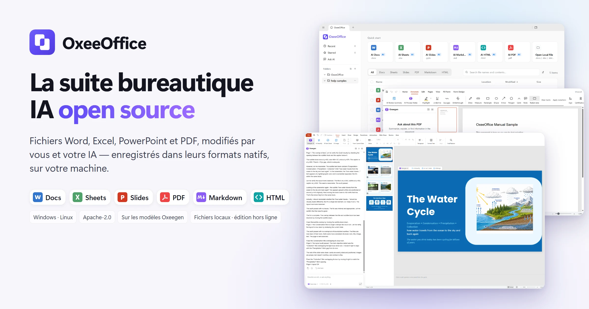
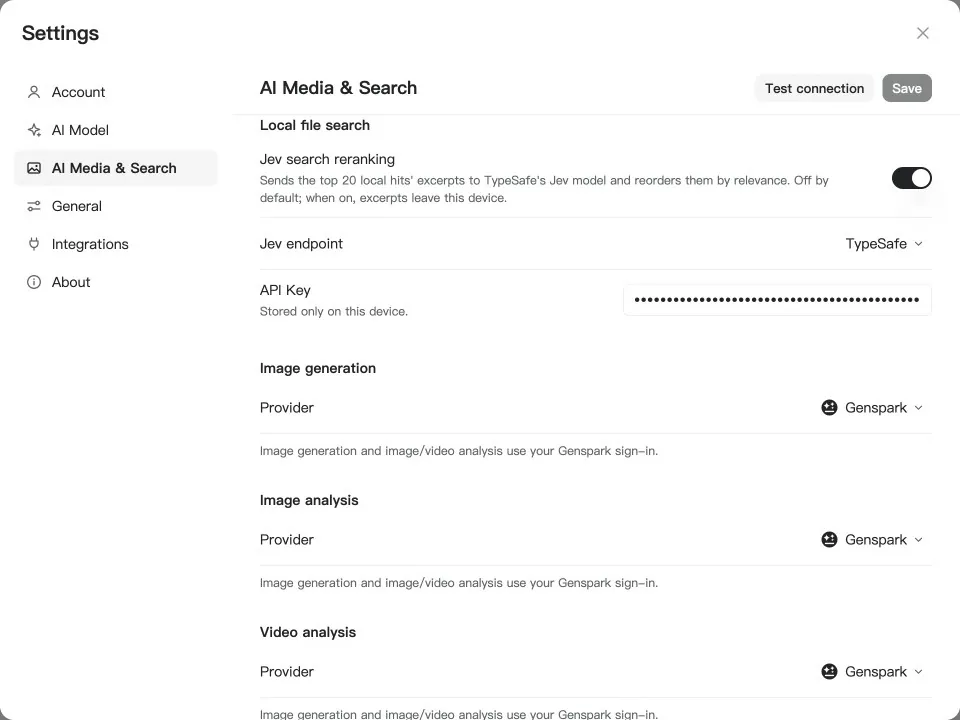
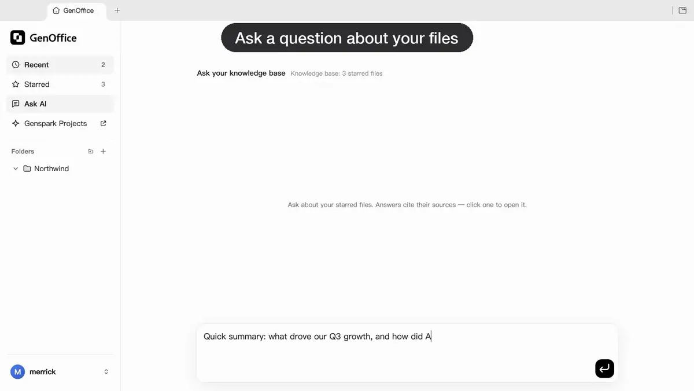

<p align="center">
  <a href="https://github.com/Oxeegen/OxeeOffice/releases/latest">
    <picture>
      <source srcset="../../brand/assets/readme/hero-fr-dark.webp" media="(prefers-color-scheme: dark)">
      
    </picture>
  </a>
</p>

<h1 align="center">OxeeOffice</h1>

<p align="center">
  <sub><a href="../../README.md">English</a> · <strong>Français</strong></sub>
</p>

<p align="center"><b>La suite bureautique IA d'Oxeegen.</b><br>
Fichiers Word, Excel, PowerPoint et PDF, modifiés par vous et votre IA, enregistrés dans leurs formats natifs —
sur les modèles d'Oxeegen.</p>

<p align="center">
  <a href="../../LICENSE"></a>
  <a href="https://github.com/Oxeegen/OxeeOffice/releases/latest"></a>
  <a href="https://github.com/Oxeegen/OxeeOffice/releases"></a>
  <a href="https://github.com/Oxeegen/OxeeOffice/stargazers"></a>
  
</p>

<p align="center">
  <a href="#download"><b>Télécharger</b></a> ·
  <a href="#skills"><b>Compétences</b></a> ·
  <a href="#command-line-and-agent-skill"><b>CLI</b></a> ·
  <a href="#mcp-server"><b>MCP</b></a> ·
  <a href="https://www.oxeegen.com"><b>Oxeegen</b></a> ·
  <a href="../../PRIVACY.md"><b>Confidentialité</b></a>
</p>

OxeeOffice est une suite bureautique de bureau pour Windows et Linux. Elle ouvre et
enregistre des fichiers natifs `.docx`, `.xlsx` et `.pptx`, permet d'éditer des PDF,
du Markdown et du HTML, et place un agent IA à côté de chaque document — pas une
simple fenêtre de chat greffée sur le côté, mais un éditeur qui lit le fichier,
effectue la modification, et vous montre exactement ce qu'il a touché. Les fichiers
OpenDocument (`.odt`, `.ods`, `.odp` et les modèles `.ott`/`.ots`/`.otp`), les anciens
fichiers Word `.doc`/`.dot`, PowerPoint `.ppt` et les documents Hancom `.hwp`/`.hwpx`
s'ouvrent comme des copies Office modifiables ; ces imports sont en lecture seule :
l'enregistrement écrit le format Office, jamais le format d'origine.

- **Formats natifs, préservés à l'octet près.** Seul ce que vous modifiez est
  réécrit. Le reste du fichier est conservé à l'identique, si bien que vos documents
  continuent de fonctionner dans Word, Excel et PowerPoint.
- **Une IA que vous pouvez vérifier.** Les modifications arrivent sous forme de suivi
  des modifications et de diffs, avec une restauration en un clic. Les feuilles de
  calcul reçoivent de vraies formules, pas des chiffres collés. Les diapositives et
  les pages sont générées directement sur le canevas et restent entièrement
  modifiables. Masquez une sélection dans Docs ou une plage de cellules dans Sheets :
  l'IA ne voit plus qu'un libellé nommé, et les mots d'origine restent dans le
  fichier. Ce masquage vaut pour l'IA de l'application — la ligne de commande, les
  outils MCP et l'export sans interface lisent le fichier directement et voient
  toujours ces mots.
- **Local par conception.** L'ouverture, l'édition, l'enregistrement et la
  conversion des fichiers se font sur votre machine. Les conversions
  PDF → Word / Excel / PowerPoint, Markdown → Word et HTML → Word s'exécutent toutes
  en local. Seuls les appels à l'IA quittent la machine, vers le fournisseur de
  votre choix.
- **Retrouvez un fichier par ce qu'il dit.** L'écran d'accueil cherche dans les
  noms, les dossiers et le texte intégral de vos fichiers `.docx`, `.xlsx`, `.pptx`,
  PDF, Markdown et HTML, à partir d'un index local, CJK compris. En option, les
  meilleurs résultats sont reclassés par **[TypeSafe Jev](https://typesafe.ai/)**,
  pour que le fichier qui répond à votre question arrive en premier.
- **Interrogez vos fichiers, sources à l'appui.** Mettez des documents en favori et
  **Demander à l'IA**, sur l'écran d'accueil, répond à vos questions en citant le
  fichier derrière chaque affirmation, pour que vous puissiez l'ouvrir et vérifier —
  et construit de nouveaux documents à partir d'eux sur demande.
- **Les modèles Oxeegen par défaut.** L'IA tourne sur l'inférence auto-hébergée
  d'Oxeegen, compatible OpenAI. Vous pouvez aussi utiliser votre propre clé pour
  Claude, OpenAI, Gemini, DeepSeek, Mistral, OpenRouter et bien d'autres, ou tout
  point de terminaison compatible OpenAI, serveurs locaux compris.
- **Scriptable et prêt pour les agents.** L'application embarque une ligne de
  commande et une compétence (skill) pour Claude Code, Codex, Cursor, Gemini CLI,
  GitHub Copilot, OpenCode et Windsurf, si bien qu'un agent de codage peut créer,
  convertir, lire et modifier de vrais fichiers Office sur votre machine sans ouvrir
  de fenêtre.
- **Mises à jour automatiques.** Les applications installées consultent les versions
  publiées sur ce dépôt et proposent chaque nouvelle version.

**À télécharger :** [Windows](https://github.com/Oxeegen/OxeeOffice/releases/latest) (x64) ·
[Linux](https://github.com/Oxeegen/OxeeOffice/releases/latest) (deb, rpm, AppImage) —
détails et prérequis dans la section [Télécharger](#download).

## Les applications

Six éditeurs, un seul panneau IA, une recherche de fichiers reclassée par TypeSafe
Jev, un « Demander à l'IA » qui répond à partir de vos favoris en citant ses sources,
et une ligne de commande pour votre agent de codage.

### 1 · Docs — ouvrez et modifiez des `.docx` avec une IA que vous pouvez vérifier

<table>
<tr>
<td width="50%"></td>
<td width="50%"></td>
</tr>
<tr>
<td><b>Ouvre le fichier comme Word le met en page</b> — sections à deux colonnes, images pleine page, tableaux ombrés, en-têtes et pieds de page, pagination fondée sur les métriques de ligne de Word. Styles, commentaires, suivi des modifications, équations, annotations manuscrites et contrôles de contenu font l'aller-retour sans être altérés. Un onglet <b>Publipostage</b> transforme le document en modèle de fusion : choisissez une liste de destinataires <code>.xlsx</code> ou <code>.csv</code>, insérez de vrais champs <code>MERGEFIELD</code>, prévisualisez enregistrement par enregistrement, puis fusionnez en un seul document, un <code>.docx</code> par enregistrement, des étiquettes ou des enveloppes.</td>
<td><b>Demandez la modification</b> — l'IA lit les blocs dont elle a besoin, réécrit la section Overview et insère une nouvelle section à puces. Chaque intervention de l'IA est un instantané que vous pouvez restaurer ; avec le <b>Suivi des modifications</b> activé, les changements arrivent sous forme de révisions à la manière de Word, à relire dans un volet de révision comme dans Word. Demandez plutôt une carte mentale et la réponse est un diagramme interactif de tout le document : branches repliables, zoom et déplacement, un clic sur un nœud pose une question de suivi, et les citations renvoient au bloc d'origine.</td>
</tr>
</table>

### 2 · Sheets — des `.xlsx` avec des formules et des graphiques vivants, pas des chiffres collés

<table>
<tr>
<td width="50%"></td>
<td width="50%"></td>
</tr>
<tr>
<td><b>Construisez-la</b> — à partir d'une seule phrase, l'agent ajoute une feuille Summary avec de vraies formules <code>SUMIF</code> par région et par catégorie, insère un graphique en colonnes, et applique les 43 modifications en un seul lot annulable.</td>
<td><b>Interrogez-la</b> — les questions sur le classeur reviennent avec le raisonnement et les cellules exactes utilisées, sous forme de citations cliquables. En coulisses : un moteur <code>.xlsx</code> en Rust, des tableaux et graphiques croisés dynamiques, des segments, la mise en forme conditionnelle, le traçage des formules, les classeurs protégés par mot de passe, et des images intégrées dans les cellules au format natif d'Excel — Excel les rouvre toujours dans la cellule.</td>
</tr>
</table>

### 3 · Slides — d'un prompt à une présentation `.pptx`


<table>
<tr>
<td width="50%"></td>
<td width="50%"></td>
</tr>
<tr>
<td><b>Une ligne en entrée</b> — « Créer une présentation investisseurs de 10 diapositives pour Aurora Home… ». L'IA planifie la trame narrative, recherche les chiffres, et rédige chaque diapositive directement sur le canevas, sous forme d'un véritable <code>.pptx</code>.</td>
<td><b>Une présentation terminée en sortie</b> — des diapositives mises en forme avec une typographie et des visuels cohérents et un appel à l'action final ; continuez à modifier avec les masques, les mises en page, les repères intelligents et le recadrage non destructif, ou demandez au panneau de restyler, réécrire et réorganiser. Insérez un <code>.glb</code> et c'est un vrai modèle 3D : faites-le pivoter en le faisant glisser dans l'éditeur ; il est enregistré comme PowerPoint enregistre la 3D, et reste en 3D dans PowerPoint.</td>
</tr>
</table>

**Diaporama → Enregistrer** narre la présentation diapositive par diapositive, avec
pause et reprise. La narration et les minutages d'avancement automatique qu'il mesure
sont enregistrés dans le `.pptx`, et PowerPoint les rejoue de la même façon.

### 4 · PDF — modifiez le texte d'un PDF sur place, convertissez un PDF en Word en local

<table>
<tr>
<td width="50%"></td>
<td width="50%"></td>
</tr>
<tr>
<td><b>Modifiez à l'intérieur de la page</b> — le mode <b>Modifier le texte</b> délimite chaque bloc de texte pour une nouvelle saisie sur place ; le flux de contenu est réécrit via PDFium avec les polices d'origine, et non par une annotation de recouvrement. Interrogez l'IA sur un long rapport et obtenez des réponses avec citations de page.</td>
<td><b>Convertissez en local</b> — <b>Convertisseur PDF → PDF vers Word</b> produit un <code>.docx</code> modifiable qui s'ouvre dans Docs à côté de la source, avec titres, lignes de statistiques et paragraphes intacts. Les cibles Excel et PowerPoint fonctionnent de la même façon ; les pages scannées passent par l'OCR du système.</td>
</tr>
</table>

Également dans l'application PDF : signature par certificat et vérification des
signatures, conception de formulaires, signets, numérotation Bates, panneau des
pièces jointes, outil de mesure étalonné, comparaison page par page, réduction de la
taille du fichier, et texte OCR enregistré dans les pages scannées pour qu'elles
restent consultables par recherche.

### 5 · HTML — un générateur IA de pages et d'interfaces, brief de design d'abord

Indiquez à quoi sert la page et à qui elle s'adresse. L'IA propose d'abord un
**brief de design** — accroche, palette, typographie et orientations stylistiques —
puis construit un fichier `.html` autonome à partir de ces jetons.


<table>
<tr>
<td width="50%"></td>
<td width="50%"></td>
</tr>
<tr>
<td><b>Générée à partir d'un seul prompt</b> — une accroche forte, des cartes de fonctionnalités, une grille tarifaire et un formulaire de liste d'attente, construits dans l'orientation Midnight Studio. Cliquez sur n'importe quel élément pour le restyler, double-cliquez pour modifier le texte, ou passez à la vue source CodeMirror.</td>
<td><b>Même design, nouvelle orientation</b> — une seule demande <b>Affiner l'UI</b> remplace les jetons du brief et la page suit : papier chaud, typographie éditoriale à empattements, accent orange soleil, sans rien réécrire. Présentez en plein écran, ou exportez en PDF ou en document Word natif et modifiable.</td>
</tr>
</table>
<table>
<tr>
<td width="50%"></td>
<td width="50%"></td>
</tr>
<tr>
<td><b>Maquettes d'interface</b> — le modèle « tableau de bord personnel » transforme un persona en une mise en page fonctionnelle : rail latéral, salutation, courbe des heures facturables, cartes de factures et de taux d'occupation, le tout en vrai HTML que vous pouvez confier à un développeur.</td>
<td><b>Récits de données</b> — le modèle « rapport de données » construit une page éditoriale grand format : titre à empattements, un chiffre phare, une ligne de statistiques séparée par un filet, des graphiques SVG intégrés et une note méthodologique.</td>
</tr>
</table>

### 6 · Markdown — un éditeur par blocs sur du `.md` brut, avec Demander à l'IA

<table>
<tr>
<td width="50%"></td>
<td width="50%"></td>
</tr>
<tr>
<td><b>Interrogez l'IA sur une sélection</b> — sélectionnez n'importe quel passage et le bouton <b>Demander à l'IA</b> apparaît : saisissez une instruction ou choisissez une suggestion, envoyez-la immédiatement, ou mettez en file plusieurs modifications ancrées et exécutez-les en une seule passe. La même entrée existe dans chaque application.</td>
<td><b>Rendu à l'écran, enregistré en Markdown brut</b> — titres, listes, tableaux, images, blocs de code, notes de bas de page et diagrammes Mermaid dans un éditeur par blocs Tiptap, réécrits en <code>.md</code> brut, avec des thèmes papier et un export <b>Markdown → Word</b> entièrement local.</td>
</tr>
</table>

**Des notes liées, comme dans Obsidian.** Les `[[liens wiki]]` mènent à la note
qu'ils nomment, taper `[[` propose de compléter le nom de la note, et `![[…]]`
intègre une note ou une image. Un panneau **Rétroliens** liste toutes les notes qui
pointent vers la note ouverte, les références de blocs et une barre latérale
d'étiquettes relient les notes entre elles, et la vue **Graphe** cartographie les
liens de tout le coffre.

<a id="search"></a>

### 7 · Recherche — trouvez le fichier qui répond à la question, avec TypeSafe Jev

Chaque fichier de votre dossier de travail est indexé en local : noms, dossiers et
texte extrait des fichiers Word, Excel, PowerPoint, PDF, Markdown et HTML, dans un
index plein texte SQLite qui découpe correctement le CJK. Activez le **Reclassement
Jev** et les 20 meilleurs résultats locaux sont évalués par
[TypeSafe Jev](https://typesafe.ai/blog/introducing-system-one-models-and-jev), un
modèle qui renvoie un score de pertinence calibré par document en un seul appel, au
lieu de générer du texte. La liste est réordonnée selon ce score ; si l'appel échoue
ou expire, l'ordre local est conservé.


<table>
<tr>
<td width="50%"></td>
<td width="50%"></td>
</tr>
<tr>
<td><b>Mêmes mots, réponses différentes</b> — « laptop refresh policy » correspond mot pour mot à une politique de cache du navigateur, à un plan de refonte de marque et à un calendrier de rafraîchissement de tableaux de bord, si bien que le classement plein texte les place en tête. Jev lit les extraits et fait remonter le document sur les normes d'équipement, celui qui fixe le cycle de remplacement à trois ans. Le badge <b>Jev</b> à côté du nombre de résultats indique quand l'ordre vient du modèle.</td>
<td><b>Désactivé par défaut, un interrupteur pour l'activer</b> — Paramètres → Médias IA et recherche → Recherche de fichiers locaux. Choisissez un point de terminaison (OpenRouter ou TypeSafe, entre autres), collez une clé, cliquez sur Tester la connexion. Les extraits des meilleurs résultats ne quittent l'appareil que lorsque l'interrupteur est activé ; l'index lui-même ne le quitte jamais.</td>
</tr>
</table>

### 8 · Demander à l'IA — vos fichiers en favori, réponses sources à l'appui

Mettez en favori les fichiers avec lesquels vous travaillez et **Demander à l'IA**,
sur l'écran d'accueil, les traite comme une base de connaissances. Posez une question
en langage courant ; l'agent cherche dans les favoris, lit ceux dont il a besoin et
répond avec une citation après chaque affirmation. Cliquez sur une citation et le
fichier s'ouvre dans la bonne application. Joignez des fichiers à la question par
glisser-déposer, par collage ou depuis le menu **+** — les images sont transmises au
modèle comme entrée visuelle — et chaque question devient sa propre conversation :
passez de l'une à l'autre, lancez-en une nouvelle, supprimez-en une ; la liste survit
à un redémarrage.



Demander à l'IA cherche dans le même index plein texte local que la
[Recherche](#search) et lit les fichiers par pages, si bien que le modèle ne voit que
les résultats et les passages qu'il a demandés, via le fournisseur de votre choix. Il
peut aussi rédiger directement un document, ou appeler la ligne de commande intégrée
pour construire un classeur ou une présentation ; chaque fichier apparaît sous forme
de carte sous la réponse, et un clic l'ouvre.

### 9 · CLI — votre agent de codage pilote OxeeOffice, sur votre machine

OxeeOffice embarque une ligne de commande et une compétence d'agent. Installez la
compétence et Claude Code, Codex, Cursor, Gemini CLI, GitHub Copilot, OpenCode ou
Windsurf peuvent créer, convertir, lire et modifier de vrais fichiers Office avec les
mêmes moteurs que les applications, sans ouvrir de fenêtre.


<table>
<tr>
<td width="50%"></td>
<td width="50%"></td>
</tr>
<tr>
<td><b>Un seul prompt à votre agent</b> — « Construis une présentation de huit diapositives sur le Système solaire. » L'agent lit la compétence, écrit une feuille de style, un plan et une spécification de page par diapositive, génère les photos avec <code>image</code>, et laisse <code>slides check</code> rejeter tout ce qui déborde ou se chevauche avant que <code>create</code> n'assemble le <code>.pptx</code> et que <code>slides render</code> ne renvoie un PNG par diapositive à examiner.</td>
<td><b>Installez une fois, depuis Paramètres → Intégrations</b> — OxeeOffice liste les agents de codage qu'il trouve sur cet ordinateur et écrit la compétence dans chacun de ceux que vous choisissez. Ou téléchargez-la en zip, ou lancez <code>npx skills add Oxeegen/OxeeOffice</code>. Les commandes et le flux complet sont dans <a href="#command-line-and-agent-skill">Ligne de commande et compétence d'agent</a>.</td>
</tr>
</table>

### 10 · MCP — les mêmes outils via le Model Context Protocol

Chaque commande est aussi un outil MCP. Claude Code, Claude Desktop, Cursor et tout
autre client MCP peuvent démarrer le serveur eux-mêmes, sans compétence à installer
ni fenêtre ouverte, et obtiennent 29 outils plus les références d'opérations comme
ressources. Un second serveur, HTTP, intégré à l'application permet à un agent de
construire un document Word dans un onglet d'éditeur visible pendant que vous
regardez.


<table>
<tr>
<td width="50%"></td>
<td width="50%"></td>
</tr>
<tr>
<td><b>Un prompt, 38 appels d'outils, aucun terminal</b> — « Construis un dossier investisseurs de huit diapositives sur les énergies renouvelables en 2026, avec une vraie photo en couverture et partout où une photo aide. » L'agent récupère chiffres et photos avec <code>search</code>, demande à <code>media</code> si chaque image candidate est une vraie photographie, appelle <code>deck_start</code> avec une feuille de style et un plan, puis <code>deck_page</code> une fois par diapositive ; chaque page est vérifiée par rapport au plan et à la palette avant d'être conservée, <code>deck_build</code> assemble le <code>.pptx</code>, <code>slides_render</code> renvoie un PNG par diapositive, et <code>deck_replace</code> reprend les pages qui ne lui conviennent pas.</td>
<td><b>Connectez une fois, depuis Paramètres → Intégrations</b> — copiez la ligne <code>claude mcp add</code> pour Claude Code, ou le bloc JSON dans Cursor, Claude Desktop ou tout autre client MCP. L'option B active le serveur HTTP local pour l'éditeur Word visible. Les deux sont décrits dans <a href="#mcp-server">Serveur MCP</a>.</td>
</tr>
</table>

## Pourquoi OxeeOffice

- **Propulsé par Oxeegen.** L'IA tourne sur l'inférence d'Oxeegen, avec un point de
  terminaison régional configurable par utilisateur — sans compte ni abonnement tiers.
- **À vous de l'exécuter.** Applications natives pour Windows et Linux ; les fichiers
  restent sur votre disque et chaque modification, enregistrement et conversion
  s'effectue sur votre machine.
- **De vrais fichiers Office.** `.docx`, `.xlsx` et `.pptx` natifs, préservés à
  l'octet près : les parties du fichier que vous n'avez pas touchées sont copiées
  telles quelles.
- **Une IA qui modifie le document lui-même.** Suivi des modifications dans Docs,
  formules et graphiques vivants dans Sheets, diapositives dessinées sur le canevas,
  chaque intervention de l'IA étant un instantané que vous pouvez restaurer.
- **Le PDF, sérieusement.** Modifiez le texte à l'intérieur de la page, et convertissez
  un PDF en Word, Excel ou PowerPoint en local, avec l'OCR du système pour les scans.
- **Markdown et HTML aussi**, avec le même panneau IA et un export local vers Word.
- **Une recherche qui trouve la réponse, pas le mot-clé.** Recherche plein texte dans
  tous les documents de vos dossiers, indexés en local, avec un reclassement
  facultatif par TypeSafe Jev.
- **Demandez à l'IA, sur tous vos fichiers.** Mettez en favori les fichiers qui
  comptent et posez vos questions en langage courant ; chaque réponse cite le fichier
  d'où elle vient, à un clic.
- **Compétences.** Des compétences prêtes à l'emploi, ou votre propre `SKILL.md`,
  à joindre depuis le menu **+** de n'importe quel panneau IA.
- **Scriptable.** Une ligne de commande, une compétence d'agent et un serveur MCP
  mettent chaque moteur au service de Claude Code, Claude Desktop, Codex, Cursor et
  d'autres agents, toujours en local.
- **Open source**, sous licence Apache-2.0, et gratuit.

## Moteurs IA

**Oxeegen** est le fournisseur par défaut : le chat et l'analyse d'images et de vidéos
tournent sur les modèles d'Oxeegen (Max, Pro, Flash, Instant) via son point de
terminaison compatible OpenAI. Dans **Paramètres → Modèle IA**, choisissez votre région
(**US** ou **EU** — chacune a ses propres clés) et collez votre clé API Oxeegen ; le
point de terminaison est renseigné pour vous. Changez de modèle à tout moment depuis le
sélecteur placé dans la zone de saisie de chaque panneau IA : ce modèle planifie avec
le raisonnement activé, puis rédige les diapositives, vérifie leur mise en page et
rédige les longs documents avec le raisonnement désactivé. Demander à l'IA, sur
l'écran d'accueil, utilise les mêmes réglages.
Aucune clé n'est jamais intégrée aux builds, puisque les versions sont publiques.

Sous **Médias IA et recherche**, la recherche web et d'images passe par **Brave
Search** — collez une clé API Brave dans l'entrée de recherche Oxeegen — et la
génération d'images utilise **OpenAI** (`gpt-image-2.5-flare`, qualité moyenne) avec
votre clé OpenAI, en attendant qu'Oxeegen propose ses propres modèles d'images.

**Ou utilisez votre propre clé.** Paramètres → Modèle IA propose aussi Claude, OpenAI,
Gemini, DeepSeek, Kimi, GLM, Qwen, Doubao, MiniMax, Grok, Mistral, OpenRouter, Requesty,
Opper, Cheaper Inference, Atlas Cloud, OpenCode Zen/Go et d'autres, ainsi que des
emplacements personnalisés pour tout point de terminaison compatible OpenAI (URL de
base + clé), serveurs de modèles locaux compris ; un point de terminaison personnalisé
peut aussi déclarer son protocole, des options de compatibilité, des en-têtes
supplémentaires et ses modèles. Les modèles qui le permettent disposent d'un réglage
d'effort de raisonnement par modèle. La recherche et les médias ont leurs propres
fournisseurs par fonctionnalité sous **Médias IA et recherche** : Serper, Serply,
SearchApi, Tavily, Parallel, Keenable, Exa ou Firecrawl pour la recherche web, et
OpenAI, Gemini, Doubao/Seedream, GLM, Grok, Qwen, MiniMax, Stability AI, FLUX,
Microsoft MAI ou tout point de terminaison d'images compatible OpenAI pour la
génération d'images et l'analyse d'images et de vidéos.

**TypeSafe Jev** reclasse la recherche de fichiers de l'écran d'accueil. Sous
**Médias IA et recherche → Recherche de fichiers locaux**, activez le Reclassement Jev
et choisissez un point de terminaison, par exemple
[OpenRouter](https://openrouter.ai/typesafe) (modèle `typesafe/jev-1.13`) ou l'API de
TypeSafe. La clé n'est stockée que sur cet appareil. Le reclassement est désactivé
par défaut ; activé, il envoie les extraits des 20 meilleurs résultats locaux pour
évaluation, et rien d'autre ne quitte la machine.

**Parallel** fonctionne sans compte : sa recherche MCP gratuite (à débit limité) sert
de recherche web de secours lorsqu'aucune clé Brave ni autre clé de recherche n'est
configurée, avant le recours à DuckDuckGo. Keenable fonctionne aussi sans clé, mais
seulement si vous le choisissez.

Toute la suite propose les thèmes clair, sombre et système. Les thèmes ne changent que
l'affichage : les exports, les impressions et les fichiers enregistrés conservent
toujours les couleurs propres au document.

<a id="skills"></a>

## Compétences

Une compétence (skill) est un fichier `SKILL.md` qui explique à l'IA comment bien
faire une tâche précise : un rapport hebdomadaire, un accord de confidentialité, un
plan de cours. OxeeOffice en fournit 40 et accepte les vôtres, dans le format utilisé
par les agents de codage.

- **Paramètres → Compétences.** **Installez** une compétence recommandée, ou
  **importez** un dossier, un zip ou un simple `SKILL.md`. Rien ne s'exécute à
  l'import.
- **Dans une conversation.** Ouvrez le menu **+** à côté de la zone de saisie de
  n'importe quel panneau IA, choisissez **Compétences**, cochez-en une, envoyez. La
  compétence n'accompagne que ce message.

---

<a id="command-line-and-agent-skill"></a>

## Ligne de commande et compétence d'agent

Tout ce que les applications peuvent faire à un fichier, la ligne de commande peut le
faire depuis un terminal : inspecter, convertir, créer, lire et modifier du Word, de
l'Excel, du PowerPoint, du PDF, du Markdown et du HTML avec les mêmes moteurs, sans
interface graphique. Elle s'installe avec OxeeOffice, ne nécessite aucun runtime
propre et n'envoie jamais un document nulle part. Associée à la **compétence d'agent**
fournie, elle transforme un agent de codage en un véritable assistant documentaire qui
produit de vrais fichiers Office plutôt que des approximations en Markdown.

> Dans cette version, la commande s'appelle encore **`genoffice`** ; elle deviendra
> `oxeeoffice` dans une prochaine version, tout comme le nom du serveur MCP et la
> compétence. Les exemples ci-dessous utilisent le nom actuel.

**Fonctionne avec :** Claude Code, Codex, Cursor, Gemini CLI, GitHub Copilot, OpenCode
et Windsurf dès l'installation, tout autre agent qui lit des compétences, et, via le
[serveur MCP](#mcp-server), Claude Desktop et tout client MCP.

### Installer la compétence

| Comment | Ce qui se passe |
| --- | --- |
| **Paramètres → Intégrations** dans l'application | Liste les agents trouvés sur cet ordinateur ; un clic écrit la compétence dans chacun de ceux que vous choisissez. Un bouton **Mettre à jour** apparaît lorsqu'une version embarque une compétence plus récente. |
| **Télécharger en zip** sur la même page | Le format que claude.ai, les applications de bureau Claude et d'autres assistants acceptent comme compétence téléversée. |
| `npx skills add Oxeegen/OxeeOffice` | Installe depuis ce dépôt dans tout agent compatible avec les skills. |

Ouvrez ensuite une nouvelle conversation et demandez un document. La compétence
apprend à l'agent quand recourir à la ligne de commande, comment lire un fichier avant
de le modifier, et comment vérifier son propre travail.

### Démarrage rapide depuis le terminal

```bash
genoffice --version
genoffice info report.docx --json                  # headings and blocks; or sheets, slides, pages
genoffice convert report.md --to pdf               # md/html/docx/xlsx/pptx → pdf, pdf → docx/xlsx/pptx/md/html, odt/ods/odp → docx/xlsx/pptx, doc/dot → docx, …
genoffice create --type docx --from notes.md --out notes.docx
genoffice create --type xlsx --from table.json --out sales.xlsx   # "=SUM(B2:B9)" cells stay live formulas
genoffice docs read report.docx --range 0-9 --json # then `docs apply --ops edits.json` edits in place
genoffice docs compare original.docx revised.docx --out redline.docx   # the differences as tracked Word revisions
genoffice render report.docx --out shots/          # one PNG per page, to look at what you made
genoffice open sales.xlsx                          # hand the result to the editor
```

Chaque commande affiche un résumé d'une ligne, ou un seul objet JSON avec `--json`.
Les modifications sont atomiques : une opération rejetée laisse le fichier intact et
renvoie une erreur explicative. `genoffice help` liste les commandes disponibles ; la
référence complète se trouve dans [packages/cli/README.md](../../packages/cli/README.md)
(en anglais).

### Ce que l'agent exécute vraiment

La présentation Système solaire ci-dessus a demandé un seul prompt dans Claude Code.
Derrière, l'agent a suivi le flux par étapes de la compétence, et la ligne de commande
a vérifié chaque étape avant de passer à la suivante :

```bash
genoffice capabilities --json                        # which cloud tools are configured
genoffice guide slides design                        # the deck workflow and layout library
genoffice image "the eight planets in a row …" --aspect 16:9 --out deck/assets/cover.jpg
genoffice slides check deck/outline.json --json      # 8 pages, no findings
genoffice slides check deck/pages/01.json --json     # builds one slide, audits overflow and overlap
…                                                    # one page file per slide, fixed until each check is clean
genoffice create --type pptx --spec deck/pages --outline deck/outline.json --out deck/solar-system.pptx --json
genoffice slides render deck/solar-system.pptx --out deck/shots --json
genoffice slides audit deck/solar-system.pptx --json    # 8 slides, no layout issues
genoffice slides replace deck/solar-system.pptx --slide 4 --spec deck/pages/05.json --json
genoffice open deck/solar-system.pptx
```

Aucun appel à un modèle n'a lieu dans la ligne de commande : l'agent réfléchit, la
ligne de commande construit et vérifie, et le résultat s'ouvre dans OxeeOffice ou
PowerPoint comme un `.pptx` ordinaire.

<a id="mcp-server"></a>

## Serveur MCP

Les mêmes commandes sont disponibles comme outils
[Model Context Protocol](https://modelcontextprotocol.io), pour les assistants qui ne
peuvent pas exécuter de terminal ou auxquels vous préférez ne pas en donner un. Il
existe trois façons de s'y connecter ; les deux premières sont présentées avec des
extraits prêts à copier dans **Paramètres → Intégrations → MCP** :

| Voie | Ce que c'est |
| --- | --- |
| **A · `genoffice mcp`** (recommandé) | Un serveur stdio que l'assistant démarre lui-même ; OxeeOffice n'a pas besoin d'être ouvert. Un outil par commande (`info`, `convert`, `create_docx`, `create_xlsx`, `create_pptx`, `create_pdf`, `docs_read` / `docs_apply` / `docs_check`, `sheet_*`, `slides_*`, `render`, `guide`, `search`, `image`, `media`, `open`), plus le flux de présentation par étapes `deck_start` → `deck_page` → `deck_build` → `deck_replace`. Les opérations, les spécifications et le Markdown sont transmis directement, si bien qu'un client sans système de fichiers fonctionne aussi. |
| **B · Serveur HTTP local** | Tourne dans l'application sur `http://127.0.0.1:3093/mcp` (Streamable HTTP, avec SSE pour les anciens clients). Ses outils pilotent un onglet d'éditeur Word visible — `create_session`, `insert_content`, `replace_blocks`, `apply_ops`, `read_document`, `save_session` — pour que vous voyiez le document prendre forme. Désactivé par défaut ; activez-le dans le même panneau de réglages. |
| **C · `genoffice mcp --http`** | Les outils stdio servis en Streamable HTTP pour des clients situés sur d'autres machines : un conteneur, un bac à sable, une machine partagée sur votre réseau. Les fichiers voyagent avec les appels : `PUT /files/<nom>` en téléverse un et renvoie une URL, chaque paramètre `file` accepte une URL http(s), et un outil qui écrit un fichier le renvoie sous forme d'URL de téléchargement. `--host 0.0.0.0` l'ouvre au réseau, `--token` le protège. |

```bash
# Claude Code
claude mcp add --transport stdio genoffice -- genoffice mcp
```

```jsonc
// Cursor, Claude Desktop ou tout autre client MCP
{ "mcpServers": { "genoffice": { "command": "genoffice", "args": ["mcp"] } } }
```

```bash
# Sur la machine où OxeeOffice est installé (réseau privé ; ajoutez --token pour une machine partagée)
genoffice mcp --http 3093 --host 0.0.0.0 --token "$GENOFFICE_MCP_TOKEN"

# Depuis le client : téléversez, puis utilisez l'URL partout où un outil attend un fichier
curl -T report.docx -H "Authorization: Bearer $GENOFFICE_MCP_TOKEN" http://server:3093/files/
#   → { "url": "http://server:3093/files/<id>/report.docx", ... }
#   docs_read({ "file": "http://server:3093/files/<id>/report.docx" })
#   docs_apply(...) → output_url, téléchargeable avec curl -o
```

En HTTP, chaque session dispose d'un dossier de travail privé, les chemins relatifs
et les dossiers de présentation s'y résolvent, `open` n'est pas proposé, et si
`GENOFFICE_ALLOWED_ROOTS` n'est pas défini, les outils ne peuvent pas sortir de
l'espace de fichiers du serveur. `render`, `convert` vers PDF et `create_pdf`
démarrent tout de même un processus OxeeOffice masqué : une machine sans écran a donc
besoin de l'application installée et d'un affichage virtuel (`xvfb-run`).

`genoffice` désigne ici la ligne de commande fournie avec l'application — sous Windows
`%LOCALAPPDATA%\Programs\OxeeOffice\resources\cli\genoffice.cmd`, sous Linux
`/usr/bin/genoffice` ; le panneau de réglages affiche le chemin exact de votre
installation. Le serveur embarque ses propres instructions de travail et expose les
références d'opérations comme ressources : aucune compétence n'est nécessaire, et la
compétence et le serveur MCP peuvent coexister, l'assistant choisissant l'un ou
l'autre. Les fonctionnalités cloud (`search`, `image`, `media`) passent par le
fournisseur configuré dans OxeeOffice ; tout le reste tourne en local, et
`GENOFFICE_ALLOWED_ROOTS` limite chaque outil aux dossiers que vous indiquez.

Voici à quoi ressemble, côté protocole, la présentation sur les énergies
renouvelables ci-dessus : un seul prompt dans Claude Code, avec uniquement le serveur
MCP connecté.

```text
capabilities · guide(slides, spec) · guide(slides, design)
search(query) ×4                         → IEA, BNEF and IRENA figures for the slides
search(query, images) ×7 · media(url, ask) ×7
                                         → candidate photos, each one checked to be a real photograph
deck_start(dir, style, outline)          → outline checked: 8 pages to write
deck_page(dir, 0, page) … deck_page(dir, 7, page)
                                         → each page checked against the outline and the palette; one page sent again
deck_build(dir, out)                     → renewables-2026.pptx, no image failures
slides_audit(file) · slides_render(file, out)
                                         → no layout findings; 8 PNGs come back as image content
deck_replace(dir, n, page) ×3 · slides_render(file, out)
                                         → three pages fixed after looking at the renders
```

Trente-huit appels, et l'assistant n'a jamais touché à un terminal : les chiffres, les
photos, les guides, les vérifications et les rendus ont tous transité comme résultats
d'outils MCP. Seuls `search` et `media` ont quitté la machine, vers le fournisseur
configuré dans OxeeOffice.

<a id="download"></a>

## Télécharger

| Plateforme | Prérequis | Téléchargement |
| --- | --- | --- |
| **Windows** (x64) | Windows 10+, Intel/AMD | [`OxeeOffice-<version>-setup.exe`](https://github.com/Oxeegen/OxeeOffice/releases/latest) |
| **Linux** — Debian / Ubuntu | x86_64, glibc 2.34+ (Ubuntu 22.04 ou plus récent) | [`oxeeoffice_<version>_amd64.deb`](https://github.com/Oxeegen/OxeeOffice/releases/latest) |
| **Linux** — Fedora / RHEL / openSUSE | x86_64, glibc 2.34+ (Fedora 35+, RHEL 9+, Leap 15.6+) | [`oxeeoffice-<version>.x86_64.rpm`](https://github.com/Oxeegen/OxeeOffice/releases/latest) |
| **Linux** — autres distributions | x86_64, glibc 2.34+, FUSE 2 | [`OxeeOffice-<version>.AppImage`](https://github.com/Oxeegen/OxeeOffice/releases/latest) |

L'installateur Windows et l'AppImage se mettent à jour d'eux-mêmes ; les installations
deb et rpm se mettent à jour via le gestionnaire de paquets. Les installateurs ne sont
pas signés : au premier lancement, Windows SmartScreen affiche un avertissement —
choisissez **Informations complémentaires → Exécuter quand même**. Aucune version macOS
n'est proposée : sans certificat Apple Developer, Gatekeeper refuse l'application.

Les nouveautés de chaque version sont dans [CHANGELOG.md](../../CHANGELOG.md) (en
anglais) ; les versions précédentes sont sur la page
[Releases](https://github.com/Oxeegen/OxeeOffice/releases).

<details>
<summary><b>Installation sous Linux</b></summary>

Le paquet deb s'installe avec apt — il récupère les dépendances et ajoute OxeeOffice
au menu des applications :

```bash
sudo apt install ./oxeeoffice_<version>_amd64.deb
```

Sur Fedora / la famille RHEL / openSUSE, installez plutôt le paquet rpm :

```bash
sudo dnf install ./oxeeoffice-<version>.x86_64.rpm     # Fedora / famille RHEL
sudo zypper install ./oxeeoffice-<version>.x86_64.rpm  # openSUSE
```

Les paquets deb et rpm configurent aussi l'assistant de bac à sable de Chromium et le
profil AppArmor dont Ubuntu 24.04 et les versions suivantes ont besoin, et ajoutent
des modèles vierges pour Dolphin, sous KDE Plasma : clic droit dans un dossier →
**Créer un nouveau** propose _OxeeOffice Document_, _OxeeOffice Spreadsheet_ et
_OxeeOffice Presentation_. Ils sont placés dans `/usr/share/templates` et supprimés
avec le paquet.

L'AppImage s'exécute sur place : installez le runtime FUSE 2 (`sudo apt install libfuse2` ;
sur Ubuntu 24.04 le paquet s'appelle `libfuse2t64`), rendez le fichier exécutable, puis
lancez-le :

```bash
chmod +x OxeeOffice-<version>.AppImage
./OxeeOffice-<version>.AppImage
```

</details>

## Fonctionnement

Sept applications Electron — Docs, Sheets, Slides, PDF, Markdown, HTML et la fenêtre à
onglets qui les réunit — partagent une même couche moteur faite de paquets TypeScript
purs, plus un sidecar Rust pour le `.xlsx`. Le fichier d'origine fait toujours foi :
les modifications sont appliquées sous forme de correctifs ciblés, et tout ce que
l'éditeur n'a pas touché traverse l'aller-retour intact.

```
open docx ─► archive original by hash (never touched)
          ─► parse word/document.xml into a block tree, each block anchored to its original XML
          ─► Tiptap editor (manual + AI editing, dirty tracking)
save      ─► dirty blocks → OOXML fragments (referencing existing styles only)
          ─► splice into the original document.xml; untouched blocks keep their bytes
          ─► repack the zip; every other entry is copied byte-for-byte
```

La visite paquet par paquet (moteurs docx/pptx, `pdf2docx`, `html2docx`, le cœur des
agents et les fournisseurs) se trouve dans
[CONTRIBUTING.md](../../CONTRIBUTING.md#engine-packages) (en anglais).

<a id="legacy-and-odf-files-open-as-converted-copies"></a>

### Les anciens formats et l'ODF s'ouvrent en copies converties

Les formats qu'OxeeOffice ne sait pas réécrire — les anciens Word `.doc`/`.dot`,
PowerPoint `.ppt`, Hancom `.hwp`/`.hwpx`, Excel 97 `.xls`, `.tsv` et la famille
OpenDocument (`.odt`, `.ott`, `.ods`, `.ots`, `.odp`, `.otp`) — sont des imports, pas
des fichiers natifs. En ouvrir un le convertit sur votre machine en une copie `.docx`,
`.xlsx` ou `.pptx`, et c'est cette copie qui s'ouvre ; l'original n'est jamais
modifié.

- Docs et Slides demandent d'abord où placer la copie (par défaut, le `.docx`/`.pptx`
  voisin de l'original), si bien que tous les enregistrements suivants y aboutissent.
- Sheets ouvre directement le classeur converti et fait passer le premier
  enregistrement par Enregistrer sous, vers un nouveau `.xlsx`. Le `.csv` fait
  exception : il garde son identité et Enregistrer réécrit les valeurs dans le `.csv`,
  comme Excel.
- La conversion est à sens unique et peut perdre des fonctionnalités que le format
  d'origine porte mais pas les formats Office. Les formats `.doc`, `.hwp` et ODF
  affichent une confirmation qui le dit ; cochez « Convertir sans demander la
  prochaine fois » pour la passer, et « Demander avant de convertir les anciens
  fichiers », dans Paramètres → Général, la réactive.

## Développement

```bash
npm install
npm run fixtures     # generate test .docx fixtures
npm test             # engine + app unit tests
npm run typecheck    # tsc --noEmit across every workspace
npm run dev          # all six editors + shell against Vite dev servers
npm run dev:docs     # a single app (same pattern works per workspace)
```

L'application Sheets nécessite une chaîne d'outils Rust pour son sidecar xlsx (`cargo`
dans le PATH). Les installateurs sont construits par le workflow de release. La
configuration, les vérifications, les releases et les pull requests sont décrites dans
[CONTRIBUTING.md](../../CONTRIBUTING.md) (en anglais).

## Assistance

- **Signalez un bug ou proposez une fonctionnalité** dans les
  [issues GitHub](https://github.com/Oxeegen/OxeeOffice/issues).
- **Mettez une étoile au dépôt** si OxeeOffice vous est utile.

## FAQ

<details>
<summary><b>OxeeOffice est-il gratuit ?</b></summary>

Oui. Les applications sont gratuites et open source, sous licence Apache-2.0. Les
fonctionnalités IA utilisent l'inférence Oxeegen ou la clé du fournisseur que vous
configurez.

</details>

<details>
<summary><b>OxeeOffice peut-il ouvrir les fichiers Microsoft Word, Excel et PowerPoint ?</b></summary>

Oui. OxeeOffice ouvre et enregistre des fichiers natifs `.docx`, `.xlsx` et `.pptx`.
L'enregistrement préserve le fichier à l'octet près : les parties que vous n'avez pas
touchées sont réécrites à l'identique, si bien que les documents continuent de
fonctionner dans Microsoft Office. Les anciens fichiers `.doc`/`.dot`, `.ppt` et `.xls`
s'ouvrent aussi, sous forme de copies converties — voir
[Les anciens formats et l'ODF s'ouvrent en copies converties](#legacy-and-odf-files-open-as-converted-copies).

</details>

<details>
<summary><b>OxeeOffice fonctionne-t-il hors ligne ?</b></summary>

L'édition des documents est entièrement locale — les fichiers ne quittent jamais votre
machine pour être ouverts, modifiés, enregistrés ou convertis. Les fonctionnalités IA
ont besoin d'une connexion réseau vers Oxeegen ou vers le fournisseur que vous avez
configuré.

</details>

<details>
<summary><b>OxeeOffice peut-il modifier des PDF ?</b></summary>

Oui — une véritable édition du texte et des images d'un PDF, qui réécrit le flux de
contenu de la page en conservant les polices d'origine, et non des annotations de
recouvrement.

</details>

<details>
<summary><b>OxeeOffice peut-il convertir un PDF en Word, Excel ou PowerPoint ?</b></summary>

Oui — entièrement en local : extraction caractère par caractère avec PDFium et analyse
géométrique de la mise en page, sans service cloud ni téléversement. Sous Windows, les
pages scannées passent par l'OCR du système et se convertissent en texte modifiable
plutôt qu'en image de page.

</details>

<details>
<summary><b>Puis-je utiliser un autre modèle d'IA ou ma propre clé API ?</b></summary>

Oui. Oxeegen est le fournisseur par défaut, et les paramètres acceptent aussi des clés
pour Claude, OpenAI, Gemini, DeepSeek, Kimi, GLM, Qwen, Doubao, MiniMax, Grok, Mistral,
OpenRouter et bien d'autres, ou tout point de terminaison compatible OpenAI, serveurs de
modèles locaux compris. La recherche, la génération d'images et l'analyse d'images et
de vidéos ont leurs propres clés sous Paramètres → Médias IA et recherche.

</details>

<details>
<summary><b>Puis-je désactiver le panneau IA ?</b></summary>

Oui. Paramètres → Général propose l'interrupteur **Afficher le panneau IA**. Désactivé,
chaque éditeur masque le panneau, et les nouveaux documents ne l'ouvrent plus d'eux-mêmes.
Une action IA explicite — un bouton du ruban, un élément de menu — ouvre toujours le
panneau pour ce document, et le fermer le masque à nouveau.

</details>

<details>
<summary><b>OxeeOffice peut-il convertir du HTML en Word ?</b></summary>

Oui — Exporter en Word, dans l'application HTML, produit un `.docx` natif et modifiable,
entièrement en local. La page est rendue dans le Chromium intégré puis ramenée à de
vraies structures Word : titres, paragraphes, listes, tableaux, cartes, lignes de KPI,
champs de formulaire et arrière-plans de page ; seuls les visuels sans équivalent Word
(graphiques, icônes, encadrés décorés) sont intégrés comme images.

</details>

<details>
<summary><b>Puis-je piloter OxeeOffice depuis Claude Code, Codex, Cursor ou un script ?</b></summary>

Oui, avec la ligne de commande et la compétence d'agent fournies, ou avec le serveur
MCP. Voir [Ligne de commande et compétence d'agent](#command-line-and-agent-skill).

</details>

<details>
<summary><b>OxeeOffice collecte-t-il des données ?</b></summary>

Non. Les builds d'OxeeOffice n'envoient aucune statistique d'utilisation : ils ne
reçoivent jamais d'identifiants d'analytics, et le workflow de release échoue si un
paquet en contient. Les documents restent sur votre machine ; seules les requêtes IA
que vous faites sont envoyées, au fournisseur que vous avez configuré.
Voir [PRIVACY.md](../../PRIVACY.md) (en anglais).

</details>

## Sécurité

Voir [SECURITY.md](../../SECURITY.md) (en anglais) pour signaler une vulnérabilité, la
sécurité des processus (isolation des renderers, validation IPC, contrôle des liens
externes) et les modèles de menace liés au contenu généré par l'IA.

## Remerciements

OxeeOffice n'existerait pas sans ces projets open source :

- [Electron](https://www.electronjs.org/) — l'environnement d'exécution de chaque
  application.
- [Univer](https://github.com/dream-num/univer) (Apache-2.0) — le cœur d'interface
  tableur que Sheets étend.
- [PDFium](https://pdfium.googlesource.com/pdfium/) (BSD-3-Clause, fourni via
  [@embedpdf/pdfium](https://github.com/embedpdf/embed-pdf-viewer)) — le moteur de
  flux de contenu derrière la véritable édition du texte et des images des PDF.
- [pdf.js](https://github.com/mozilla/pdf.js) (Apache-2.0) et
  [pdf-lib](https://github.com/Hopding/pdf-lib) (MIT) — rendu et assemblage des PDF.
- [Tiptap](https://tiptap.dev/) / [ProseMirror](https://prosemirror.net/) — les
  éditeurs par blocs de Docs et de Markdown.
- [CodeMirror](https://codemirror.net/) (MIT) — l'éditeur de source de HTML.
- [Konva](https://konvajs.org/) — le rendu canevas de Slides et des graphiques de
  Sheets.
- [HarfBuzz](https://github.com/harfbuzz/harfbuzz) (wasm) — les métriques de mise en
  forme du texte pour les écritures complexes.
- [calamine](https://github.com/tafia/calamine) et
  [IronCalc](https://github.com/ironcalc/IronCalc) — les couches de lecture et de
  calcul du sidecar xlsx en Rust.
- [libeot](https://github.com/umanwizard/libeot) (MPL-2.0) — le décodeur MicroType
  Express des polices intégrées PowerPoint, porté en TypeScript.
- [rhwp](https://github.com/edwardkim/rhwp) (MIT) — lit les documents `.hwp` binaires
  en HWPX pour l'import Hancom. « 한글 », « 한컴 », « HWP » et « HWPX » sont des marques
  déposées de Hancom Inc. ; OxeeOffice n'est pas affilié à Hancom.
- [React](https://react.dev/) (MIT) — la couche d'interface de chaque application.
- [Mermaid](https://mermaid.js.org/) (MIT) et [KaTeX](https://katex.org/) (MIT) —
  diagrammes et mathématiques dans Markdown et Docs.
- [opentype.js](https://opentype.js.org/) (MIT) — l'analyse des polices pour les
  métriques et la recherche de glyphes.
- [JSZip](https://stuk.github.io/jszip/) (MIT) et
  [fast-xml-parser](https://github.com/NaturalIntelligence/fast-xml-parser) (MIT) —
  les couches de conteneur OOXML et XML.
- [Fluent UI System Icons](https://github.com/microsoft/fluentui-system-icons)
  (MIT) — le jeu d'icônes des rubans.
- [electron-updater](https://www.electron.build/) (MIT) — les mises à jour intégrées.
- Les polices Liberation, Carlito, Caladea et Noto CJK (OFL/Apache-2.0) — polices de
  document fournies.

Toutes les dépendances d'exécution sont sous licence MIT, Apache-2.0, BSD-3-Clause ou
OFL ; les mentions complètes des composants tiers sont fournies avec l'application.

## Licence

OxeeOffice est un logiciel open source distribué sous [licence Apache 2.0](../../LICENSE).
Les mentions d'attribution et de composants tiers se trouvent dans [NOTICE](../../NOTICE).

Le dossier `ee/` relève d'une licence distincte ([ee/LICENSE](../../ee/LICENSE)) et ne fait
pas partie des builds d'OxeeOffice.

Maintenu par [Oxeegen](https://oxeegen.com).
